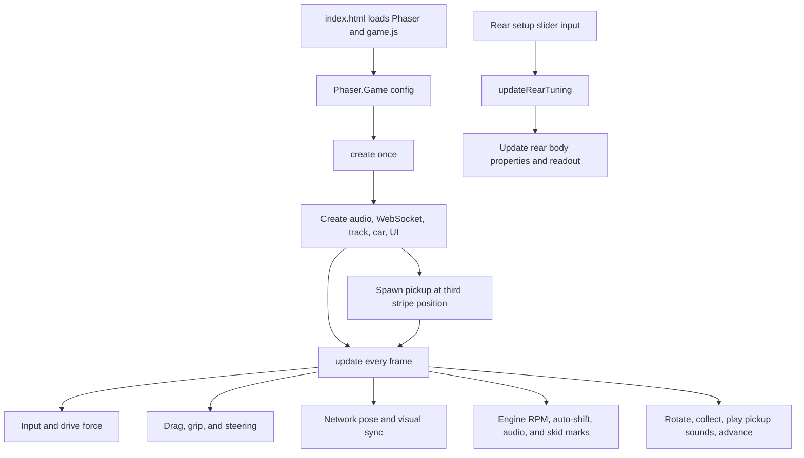

# Architecture

This project is a browser-based Phaser racing game with a small FastAPI WebSocket server. The browser owns the track, car physics, controls, sound, and rendering. The server serves the static page and relays player positions to connected clients.

## Files

- [`static/index.html`](static/index.html) loads Phaser from a CDN, defines the rear setup slider, and loads the game script.
- [`static/game.js`](static/game.js) creates and runs the game, including the Matter.js car, baked track textures, UI, audio, and multiplayer client.
- [`car.png`](car.png) is loaded as the local and remote car sprite.
- [`main.py`](main.py) serves the static files and car image, and implements the WebSocket position relay.
- [`requirements.txt`](requirements.txt) lists the Python server dependencies.

## Browser Startup

The browser loads `index.html`, which loads Phaser and then `game.js`. At script evaluation time, `game.js` defines its configuration, constants, state, and helper functions, then constructs `new Phaser.Game(config)`. Phaser calls `preload()` to load `/car.png`, creates the scene, and calls `create()` once. It then calls `update(time, delta)` repeatedly, once per frame.

### `create()` setup flow

1. Start the sampled engine loops with `initializeEngineAudio()` and start the muted procedural loop with `makeEngineBuffer()` and `playProcGenSound()`. The procedural loop remains available for the Buzz, Classic, and Combined sound options.
2. Open a WebSocket to `/ws` and register a message handler that creates or updates remote-player ghost sprites.
3. Set world bounds and call `createTrack(this)` to generate the local track and bake its road and markings into sparse 512×512 textures. It returns centerline positions at each configured stripe interval, ordered so the third position is nearest the starting car.
4. Create three outlined pickup rectangles; the pickup WAV files were loaded during `preload()`. The rectangles rotate independently; collecting the pickup plays all three sounds and advances to the next stripe position.
5. Create the front and rear Matter bodies and connect them with three springs.
6. Connect the rear setup slider to `updateRearTuning()`, which applies its values to the rear body.
7. Create transparent body-following shapes, car image sprites, and skid-mark graphics; bind keyboard input including K for replay ghosts, configure the camera, and add the zoom handler and controls text.

## Per-Frame Flow

Phaser calls `update(time, delta)` continuously after setup:

1. Send the local front-body position and rotation through the WebSocket, when connected.
2. Copy the physics body positions and angles to their transparent visual followers and sync the local car image to the bodies.
3. Rotate the pickup rectangles and check car proximity to the active pickup. On collection, play pickup sounds 2, 3, and 4 simultaneously, then move to the next stripe position.
4. Read acceleration, boost, and steering input. W or Up requests full throttle for the engine audio model; Space or Down does the same while also applying the car's boost force. Separately, acceleration and boost forces ramp toward their input values using `CAR_CONFIG.accelerationResponseSeconds`, then apply until the corresponding speed limit is reached.
5. Apply forward drag and lateral grip to both car bodies.
6. Apply the original rate-limited steering behavior. The rear setup slider adds a separate steering force that increases toward the heavier-rear end; its maximum is `CAR_CONFIG.maxRearTurnForceBoost`.
7. Update engine RPM, automatic gear shifts, and sampled engine audio. Generate skid marks while moving and steering or accelerating; skid marks expire after 450 frames.
8. Record the front-body position and rotation every four frames in a 900-position rolling buffer. Press K to spawn a translucent replay car that follows the buffered positions; spawning it clears the buffer, and the replay removes itself after reaching the last point.
9. Redraw skid marks and remove expired marks.

## JavaScript Functions

### Configuration and state

- `CAR_CONFIG` contains drive and boost force, speed limits, lateral impulse limit, damping, drag, steering rate/timing, minimum steering speed, and the maximum extra turn force for the heavy-rear setup.
- `AUDIO_CONFIG` selects the engine sound mode, which defaults to the sampled engine-audio sound with automatic gears. The selector also offers mute and the procedural Buzz, Classic, and Combined sounds.
- `ENGINE_AUDIO_CONFIG` defines the sampled engine loop assets, six automatic gear ratios, RPM shift thresholds, throttle-to-RPM response, and volume/pitch settings.
- `REPLAY_CONFIG` sets the position sampling interval (four frames), maximum queued positions (900), and replay playback interval (four frames per position).
- `REAR_TUNING` maps the slider's 0-to-1 value to rear-body density, friction, and air friction.
- `ROAD_TURN_AVERAGE_SEGMENTS` controls how many following segments contribute to the road stripe's smoothed turn color. `ROAD_FULL_BLUE_TURN_RADIANS` sets the turn angle that reaches full blue. `TRACK_TEXTURE_SIZE` and `TRACK_ROAD_HALF_WIDTH` control the sparse baked track tiles. `TRACK_STRIPE_INTERVAL` controls stripe spacing and pickup positions; `TRACK_ROAD_WIDTH` controls the dark road surface and pickup collision diameter, while `TRACK_STRIP_WIDTH` controls the colored center band. `PICKUP_CONFIG` controls rectangle appearance and rotation speeds.
- `config` configures Phaser, Matter physics, and the scene's `create` and `update` callbacks.
- Module-level variables hold the car bodies, input, camera zoom, skid-mark state, socket, remote ghost sprites, world size, engine audio state, and rear slider value. The camera starts at 0.8 zoom and wheel zoom changes by 0.0005 per delta unit.

### Functions

- `preload()` loads the car image used by the local and remote sprites and the three pickup sounds served by FastAPI.
- `createTrack(scene)` generates 720 points around a closed track, constrains the track to the world bounds, calculates smoothed segment turn factors, then rasterizes the road and markings into sparse 512×512 textures along the track. Dark and colored road strokes overlap segment ends by 20 pixels; the colored band uses 0.6 alpha. It returns positions sampled at `TRACK_STRIPE_INTERVAL` for pickup placement. The texture tiles render in place of per-frame vector Graphics drawing.
- `spawnNextPickup(scene)` places the pickup rectangles at the next sampled stripe position, cycling through the position list.
- `initializeEngineAudio(scene)` creates looping Phaser sounds from the local engine-audio samples and starts them after the browser unlocks audio playback.
- `updateEngineAudio(scene, forwardSpeed, throttle, delta)` smooths the requested audio throttle, estimates RPM from forward speed, gear, and throttle, performs automatic up/down shifts from RPM thresholds, and crossfades/pitches the loaded samples.
- `recordPlayerPosition(scene)` samples the player's front-body pose at the configured frame interval and drops the oldest pose when the buffer reaches its maximum size.
- `spawnReplayGhost(scene)` clones the queued poses into a translucent replay car, starts playback, and resets the recording buffer.
- `updateReplayGhosts(scene)` advances replay cars along their captured poses at the configured interval and destroys each car after its final pose.
- `makeEngineBuffer(ctx, rev, duration)` synthesizes a short filtered procedural engine-audio buffer for the Buzz, Classic, and Combined modes. It advances the shared engine phase and returns the audio buffer.
- `playProcGenSound(scene, audioBuffer)` plays an audio buffer and, when it ends, generates and starts the next one. This forms the continuous engine sound loop.
- `applyLateralGrip(scene, body, maxImpulse)` projects a body's velocity onto its local right axis and applies an opposing velocity change, limited by `maxImpulse`.
- `applyForwardDrag(scene, body, forwardX, forwardY, forwardSpeed)` applies a force opposing the car's forward motion, scaled by forward speed and the configured drag coefficient.
- `updateRearTuning(scene, amount, output)` interpolates the rear density, friction, and air friction from the slider value, updates the Matter body, and refreshes the displayed values. The same slider value is read by `update()` to calculate the added steering force.
- `create()` performs one-time scene setup. Phaser invokes it; it initializes the sampled engine loops, starts the procedural sound loop, calls `createTrack()`, and registers event handlers for WebSocket messages, the tuning slider, and mouse-wheel zoom.
- `update(time, delta)` is Phaser's recurring scene loop. It handles replay recording and playback, player networking, visual synchronization, input, acceleration, drag, grip, steering, engine audio and RPM, and skid-mark drawing and cleanup. Press K to spawn a replay of the queued positions.

## Engine Audio and Throttle

The project uses the `engine-audio` sample assets and follows its on/off and low/high sample crossfade approach, but does not instantiate the library's `Engine`, `Drivetrain`, or `Vehicle` classes. In the library, `Engine.throttle` is a normalized scalar consumed by its torque integration (`throttle^1.2 * torque`); the demo ramps that value by `0.2` on each animation frame while Space is held. `theta` is crank phase, not a throttle or shift control.

Here, holding W or Up sets the audio model's requested throttle to `1` (full); boost keys also request full audio throttle. The separate `engineAudioThrottle` state eases toward that target with an 80 ms rise and 160 ms fall, and is used for sample crossfading and a throttle-dependent RPM bonus. This is only an audio/RPM estimate: it does not drive Matter physics or call the library's torque integrator. The estimated RPM combines vehicle forward speed and current gear ratio with throttle RPM bonus, then triggers an upshift at `upshiftRpm` or a downshift at `downshiftRpm`. Gear changes briefly cut the on-throttle sample gain.

## Server and Multiplayer Flow

`main.py` creates the FastAPI application and a process-local `players` dictionary. Its `/car.png` route serves the root-level car asset, and `/audio/pickup-coin-{number}.wav` serves pickup sounds 2 through 4. The `multiplayer(websocket)` handler accepts each `/ws` connection, assigns it a server-side ID, then repeatedly receives a player's JSON position. It stores that position and sends the sender a list of the other connected players. On disconnect, it removes that connection from `players`.

The static-files mount serves `static/` at the site root, with `index.html` as the default page. When `main.py` is run directly, its `__main__` block starts Uvicorn on `0.0.0.0:8000` with reload enabled.

Track generation and car physics happen independently in each browser. The WebSocket currently relays position and rotation only; it does not synchronize the generated track, tuning slider, or physics state.